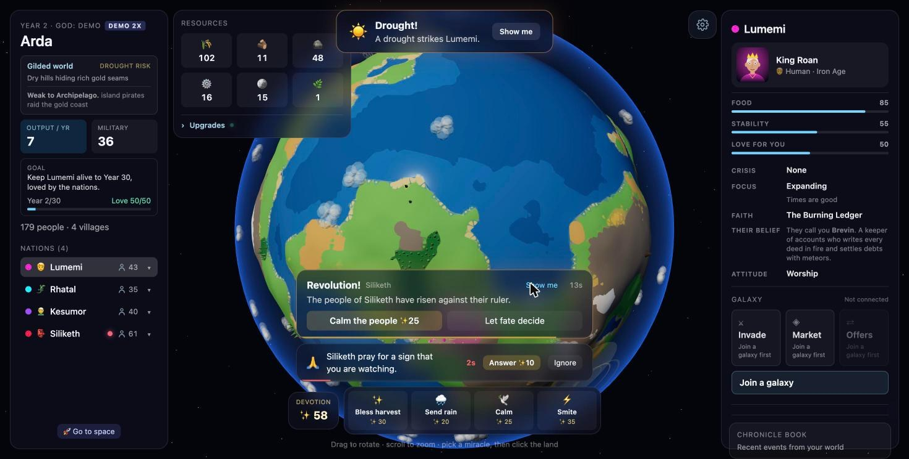

# Arda

**[▶ Play it live](https://arda-frank-3129.vercel.app)** · Built in 24 hours at WHACK26 by a team of four

A god game on your own 3D planet. Tiny AI-driven nations live on it, invent a religion about you,
pray to you, trade, go to war and climb from the Stone Age to the Space Age. Your job is to
keep your people alive and loved for 30 years. Once you reach space, you can trade with or invade
other players' planets in a shared galaxy.



## Features

- **A 3D planet** of about 27,000 tiles with elevation, moisture, forests and ore, gold and herb deposits.
  Five planet types (Verdant, Timberworld, Ironworld, Gilded, Archipelago) are each rich in different
  resources and prone to different disasters.
- **Nations with their own minds.** Each planet starts with 2–5 nations, each a different race (human,
  goblin, elf, dwarf, lizardfolk) with its own leader, borders, needs and relations with its neighbours.
  An LLM gives each nation a name, a religion and a voice. It talks to you, and it picks a policy
  (expand, farm, worship, hoard, rebel and so on) that changes how its people behave.
- **Peace, trade and war.** Tension between nations drives them between peace, trade, rivalry and war.
  At war, border villages are captured and resources fall. Warships, merchant fleets and pirates sail between them.
- **God powers** paid for with devotion: bless harvests, send rain, calm a revolution, smite, answer prayers,
  or step in when a disaster, war or revolution starts.
- **A multiplayer galaxy.** Up to five gods share a galaxy by code. Planets sync every five seconds, and
  Space Age nations can trade through a shared order book, make direct offers, or launch invasion fleets
  that the defender can fight, pay off or shield against. All of this is settled server-side in Postgres.
- **It works without an API key.** Every AI call has a pre-written fallback, so the game never stalls.

## Tech

Next.js 15 (App Router), React 19, TypeScript, Tailwind CSS 4, react-three-fiber and drei for the globe,
Supabase (Postgres functions and row-level security) for the galaxy, OpenRouter for the AI, deployed on Vercel.

- `src/sim/planet.ts`: the whole simulation (tiles, people, villages, nations, disasters, navies), stepped every frame
- `src/components/Globe.tsx`: renders the planet with instanced meshes and turns mouse drags into god powers
- `src/app/api/`: server routes for the AI (the key never reaches the browser) and the galaxy
- `supabase/migrations/`: galaxy rooms, market, trade offers and invasions as SQL functions

## Team

| | Built |
| --- | --- |
| [Frank Lynton](https://github.com/franklynton) | Project lead and integration; nations, war, races and the core simulation |
| [Shash](https://github.com/shash-v) | Database, multiplayer galaxy and the market order book |
| [Abel Linas](https://github.com/linaslabs) | Economy, upgrades and balancing |
| [Piyush Gurnani](https://github.com/piyushgurnani06) | AI voice, effects, polish and the pitch |

## Run it locally

```bash
npm install
cp .env.example .env.local   # optional: add an OpenRouter key for live AI dialogue
npm run dev
```

Open http://localhost:3000, name yourself and create your planet. For multiplayer, create a Supabase project,
add its URL and keys to `.env.local` (see `.env.example`), and run the files in `supabase/migrations/` in order.
